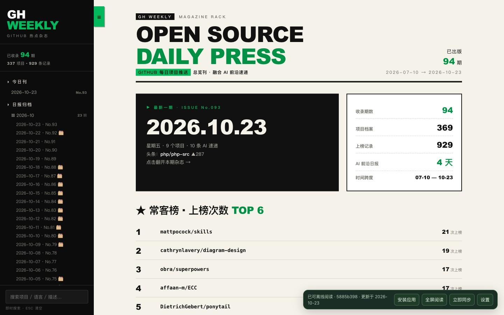
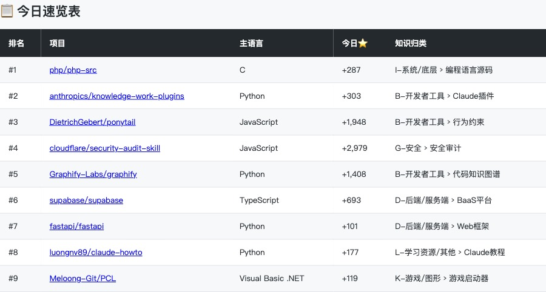
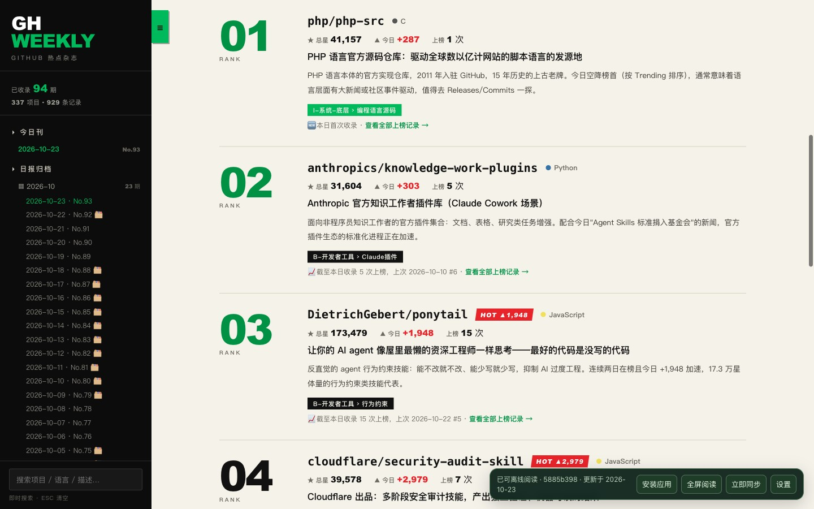
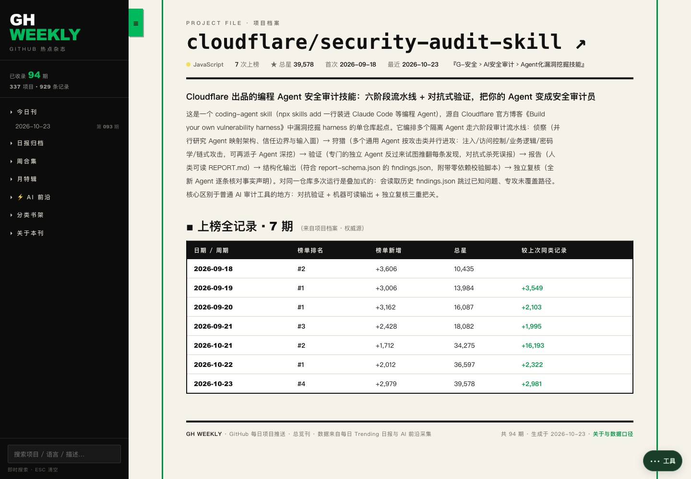
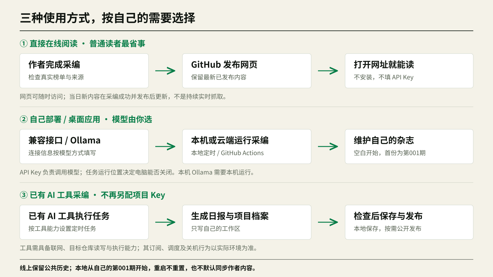
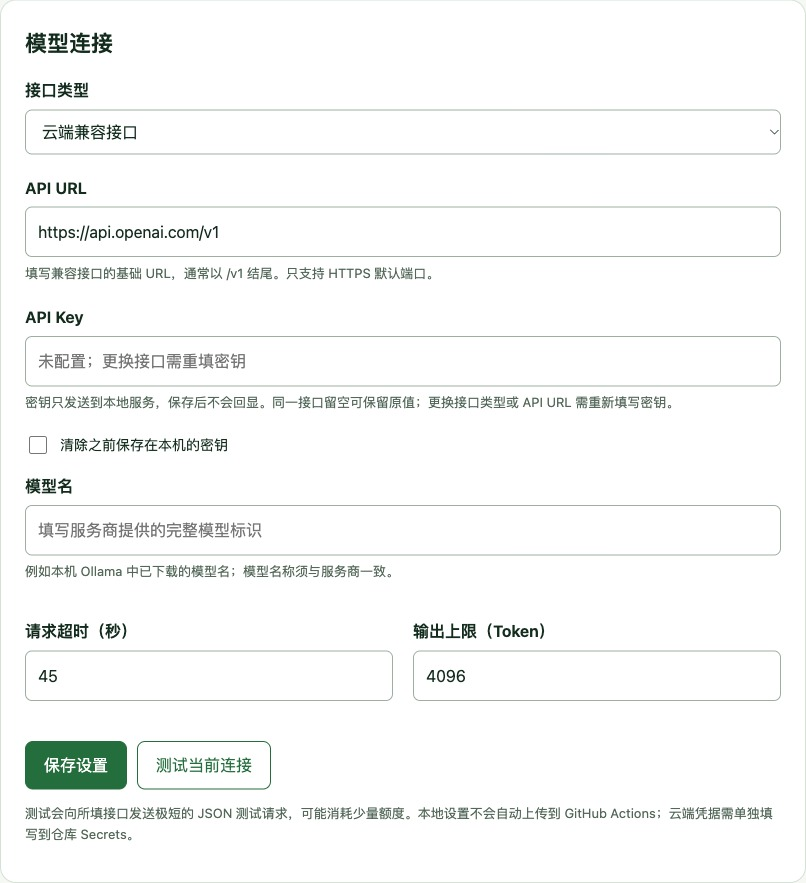

# GitHub 每日项目推送

[English](README.en.md) | 中文


**把 GitHub 热榜、AI 前沿资讯和项目档案，放进一本可以在线读、安装到桌面、离线翻阅的中文杂志。**

每天发现新项目，也能沿着历史继续看懂它。黑绿杂志界面把日报、周报、月报、分类和项目时间线串在一起：打开就能读，感兴趣再追到来源。

[图文项目介绍](https://0505ttt.github.io/github-daily-press/docs/项目介绍.html) · **[打开在线杂志](https://0505ttt.github.io/github-daily-press/)** · [下载与安装](https://github.com/0505ttt/github-daily-press/releases/latest) · [三种使用方式](#选择适合自己的使用方式) · [使用文档](#文档与验证)

只想看热点？直接打开在线杂志即可，**不用安装、不用账号、不用填写 API Key**。想把它装到自己的电脑、选择自己的模型，或者交给已有 AI 工具采编，也都有对应入口。

## 先看阅读体验



*首页保留杂志的大标题与黑绿配色，从本期热点进入，也可以搜索历史、切换刊期和分类。*

| 你想做什么 | 这里怎么读 |
| --- | --- |
| 快速了解今天的开源动向 | 看风向摘要、项目卡片和榜单速览 |
| 跟进 AI 新进展 | 阅读带来源链接的 AI 前沿速递 |
| 找回看过的工具 | 搜索历史内容，按分类浏览项目档案 |
| 判断一个项目是否持续受关注 | 查看上榜时间线、历史排名与当时的星数 |
| 把内容带到没有网络的地方 | 安装为网页应用，缓存完成后离线阅读 |

### 从一份日报，到一个项目的历史



*2026-10-23 实际榜单返回 9 个项目。先看速览，再进入项目介绍；没有补造第十名。*



*日报把项目介绍、适用方向和来源放在同一处，便于先了解，再决定是否深入。*



*上图点开当日榜单中的 Cloudflare 安全审计项目，查看介绍和 7 次历史上榜记录。档案保留语言、分类和上榜记录。文中截图展示公共杂志的历史样例，摄于 2026-10-23，数值不代表实时数据；首次安装的本地应用为空白，不附带这些历史。*

## 选择适合自己的使用方式



| 方式 | 适合谁 | 需要 API Key 吗 | 电脑关闭后呢 |
| --- | --- | --- | --- |
| **① 直接看在线杂志** | 只想发现热点、查询项目历史 | 不需要 | 已发布网页仍可访问；更新取决于采编任务何时成功完成 |
| **② 自己部署，自己选模型** | 想维护自己的内容或安装桌面应用 | 第三方接口通常需要；Ollama 不需要 | 本机采编需开机；部署在 GitHub Actions 的采编在云端运行 |
| **③ 交给已有 AI 工具采编** | 已使用 ZCode、Claude Code、Hermes、Kimi Code 等工具 | 不必再为本项目单独填写 | 本机工具需开机；云端工具由其运行环境与调度能力决定 |

API URL、Key 和模型名只是**模型连接信息**。任务在自己的电脑还是 GitHub 云端运行，才决定电脑能否关闭。本地 Ollama 与第三方兼容接口是同一条使用路径中的两种模型选择。

**公共杂志和你的本地杂志分别保存。** 线上保留作者已发布的完整历史；本地首次启动是自己的空白工作区，不预装作者日报，也不默认同步作者仓库。首次成功生成自己的日报就是**第 001 期**，以后逐期累计，关闭应用或重启电脑不会重置。

### ① 直接在线阅读

打开 **[GitHub 每日项目推送 · 在线杂志](https://0505ttt.github.io/github-daily-press/)**。作者完成当日采编并发布后，网页会更新，读者无需启动项目。页面展示最新已发布的内容，**不是持续实时抓取榜单**。

在线页面也支持全屏阅读和 PWA 安装；等待“可离线阅读”后，可以继续翻阅已缓存的内容。恢复网络后检查新版本，内容日期以页面显示为准。

### ② 安装到桌面，或从源码运行

从 **[Releases](https://github.com/0505ttt/github-daily-press/releases/latest)** 按操作系统选择文件。**桌面安装包与源码 ZIP 是两类文件**：安装包用于日常启动应用，源码包用于自行运行、修改与部署。具体平台文件及验证范围以该版本说明为准。

下面是**源码运行方式**。安装 Python 3.11 或更新版本，下载本仓库并解压，或使用 Git 克隆。

| 系统 | 启动方式 |
| --- | --- |
| Mac | 双击 `启动.command`；若无法直接执行，在本目录运行 `bash 启动.command` |
| Windows | 双击 `启动.bat`；安装 Python 时请启用 Python 启动器 |

首次运行会联网安装依赖，并打开 **`http://127.0.0.1:8765/`**。本地应用从空白工作区开始，**不配置模型也能先打开应用与设置**；生成内容时再选择模型，或交给已有 AI 工具。源码运行的依赖安装步骤不适用于已封装运行时的桌面安装包。

源码仓库保留公共网站的历史文件，默认启动应用时不会把这些文件装进你的本地资料。使用 `python -m gh_daily workspace` 查看本机工作区位置；资料持久保存在用户数据目录。

<details>
<summary>使用命令行启动</summary>

Mac / Linux：

```bash
python3 -m venv .venv
.venv/bin/python -m pip install -e .
.venv/bin/python -m gh_daily serve --open
```

Windows：

```powershell
py -3 -m venv .venv
.venv\Scripts\python.exe -m pip install -e .
.venv\Scripts\python.exe -m gh_daily serve --open
```

</details>

### 网页安装为 PWA

用 Chrome 或 Edge 打开在线网址或本地地址，展开右下角“工具”并点击“安装应用”，或使用浏览器菜单中的“安装此页面为应用”。之后可以从系统应用图标进入独立窗口，**没有地址栏、标签页和书签栏**；需要沉浸阅读时，再点“全屏阅读”。工具菜单默认收起，点击外部或按 Esc 即可关闭。PWA 是浏览器提供的安装方式，与 Releases 中的桌面安装包分别提供。

等待页面显示 **“可离线阅读”** 后，可以继续阅读缓存中的内容。

在线 PWA 更新需要网络。本地地址安装的 PWA 图标本身不会启动 Python 服务；设置模型、生成或同步新内容时，先运行本地启动脚本。桌面安装包的启动与运行时由安装包管理，具体说明见对应版本。

## 接入自己的模型



在自己运行的本地应用展开右下角“工具”→“设置”，在“模型连接”中填入自己的服务信息，可以先测试连接再保存。如果本地服务已停止，阅读页会显示启动说明，重新打开桌面应用或运行启动脚本后再进入设置。**在线公共阅读页不提供个人密钥配置入口**；只是阅读，或采用下面的 AI 工具采编方式，都无需在此填写。

| 方式 | 需要准备 |
| --- | --- |
| 第三方兼容接口 | API URL、API Key、模型名 |
| 本地 Ollama | 正在运行的 Ollama、本地服务地址、已下载的模型名 |

支持调整超时与输出上限。云端接口默认要求 HTTPS；Ollama 使用回环地址。**密钥仅保存在用户配置目录，保存后不回显**，不会写入公开页面或阅读缓存。

详细填写示例和常见问题见[安装与模型设置](docs/安装与模型设置.md)。

### ③ 用已有 AI 工具采编

如果已经使用可以联网、读写仓库并执行任务的 ZCode、Claude Code、Hermes、Kimi Code 等工具，可以直接让它整理真实资料、生成日报并更新项目档案，**不必再给本项目配置一份模型 API Key**。

先用 `python -m gh_daily workspace` 找到本机工作区，再让工具将自己的日报与档案写入那里。不要为了开始自己的第一期，复制公共仓库中已有的全部历史。

工具本身可能需要订阅或按量付费。ChatGPT 等产品只有在所用环境确实能读写目标仓库、联网并执行调度时，才能完成整条流程；不能仅凭产品名称推断它会在关机后操作本机文件。完整可复制指令见 [AI 工具采编](docs/AI工具采编.md)。

## 让内容持续更新

**作者采编与读者阅读是两件事。** 作者的工具生成日报 → 将检查通过的公开内容保存到 GitHub → GitHub Pages 发布网页 → 大家打开同一个网址阅读。网站在线时，作者的电脑不必一直开着；如果采编工具运行在作者本机，生成当日新内容时仍需要本机运行。

如果想让自己的内容在电脑关闭时也生成，可以在**自己的 GitHub 仓库**启用 Actions、配置云端模型服务。到点后 GitHub 会启动一台临时的云端电脑，运行项目采编、保存公开结果，然后结束任务。API Key 用来调用模型，GitHub Actions 负责运行程序。

默认计划为每天北京时间 **08:30**；周一增加周报，每月第一天聚合上月真实数据生成月报。GitHub 调度可能延迟，也可以手动触发。使用 Ollama 的本机采编可以这样运行：

```bash
python -m gh_daily update
python -m gh_daily serve --schedule
```

以上命令请使用虚拟环境中的 Python；本地定时需要电脑开机、服务保持运行。GitHub 云端的 `localhost` 指它自己的云端电脑，不能直接连接个人电脑里的 Ollama。

本地应用**默认不选择同步仓库**。需要同步自己的其它设备，或主动阅读某个信任的公开仓库时，才在设置中填写 `owner/repository` 后点击“立即同步”，仓库默认分支使用 `main`。同步只更新阅读数据，保留本地代码和配置。直接看作者每日内容，打开在线网址即可。完整步骤见[云端自动更新](docs/云端自动更新.md)和[自动采编](docs/自动采编.md)。

## 内容可追溯，统计有边界

- **真实榜单**：排名与星数来自 GitHub Trending 实际页面，项目介绍依据仓库资料；缺失数据明确标注。
- **来源在场**：AI 资讯先采集材料，再交给模型归纳；只引用已采集的来源，材料不足时允许少报。
- **历史有时间**：补档保留 Wayback 快照标识与原链接，快照星数不代表当前值。
- **失败可见**：采编任务分别记录状态，失败时保留上一份有效内容；重复执行不重复归档或计数。
- **资料可带走**：仓库附带公开的 HTML、Markdown、PDF 与项目档案，另保留单文件离线杂志。PDF 作为独立史料，不混入可解析 HTML 的榜单统计。

参见[数据来源](数据来源.md)、[补档说明](补档说明.md)与[第三方资料说明](NOTICE.md)。

## 文档与验证

| 文档 | 内容 |
| --- | --- |
| [安装与模型设置](docs/安装与模型设置.md) | 启动、PWA 安装、API 与 Ollama 配置、故障排查 |
| [桌面安装包](docs/桌面安装.md) | Mac／Windows 文件选择、独立窗口与个人刊物 |
| [云端自动更新](docs/云端自动更新.md) | Actions、Secrets、定时采编与本地同步 |
| [AI 工具采编](docs/AI工具采编.md) | 不另配项目 Key 的采编方式、可复制任务指令与发布步骤 |
| [自动采编](docs/自动采编.md) | 数据来源、任务流程与失败重试 |
| [验收记录](docs/验收记录.md) | 已完成的检查及平台验证范围 |
| [发布文件清单](docs/发布文件清单.json) | 公开发布文件与校验信息 |

截至 **2026-10-23**，在线网站已实际部署；Mac 上已验证桌面应用空白首启、关窗停止服务，以及 PWA 安装与离线冷启动。本轮 Python 与三套 JavaScript 回归覆盖折叠工具、设置断连恢复、缓存更新和导入隐私规则。**自动构建、平台实机、真实云端采编分别验收**；本次版本的实际运行链接与未验证范围见 [Release 说明](https://github.com/0505ttt/github-daily-press/releases/latest)及[验收记录](docs/验收记录.md)。

<details>
<summary>开发与维护常用命令</summary>

以下命令使用已安装依赖的虚拟环境 Python 执行。

| 命令 | 用途 |
| --- | --- |
| `python -m gh_daily serve` | 启动本地应用 |
| `python -m gh_daily workspace` | 查看独立的本机内容工作区 |
| `python -m gh_daily --root "本机工作区" build` | 从自己的已有资料重新构建 |
| `python -m gh_daily update` | 真实联网采编 |
| `python -m gh_daily sync --repo owner/repository` | 同步公开阅读内容 |
| `python -m gh_daily --root "本机工作区" import-content --source "AI输出目录"` | 将 AI 生成资料导入自己的本地杂志 |
| `python -m gh_daily --root . publish` | 在独立公开仓库检查并提交限定的公开产物 |
| `python -m gh_daily doctor` | 检查本地状态 |
| `python -m gh_daily --root . privacy` | 扫描当前公开仓库资料 |
| `python -m unittest discover -s tests -v` | 执行回归测试 |

</details>

## 许可与贡献

原创代码采用 [MIT](LICENSE)。第三方项目、新闻、论文及历史材料保留各自权利，详情见 [NOTICE](NOTICE.md)。欢迎按[贡献说明](CONTRIBUTING.md)反馈问题或改进阅读体验；请勿在 Issue 中粘贴真实密钥或私人配置。
