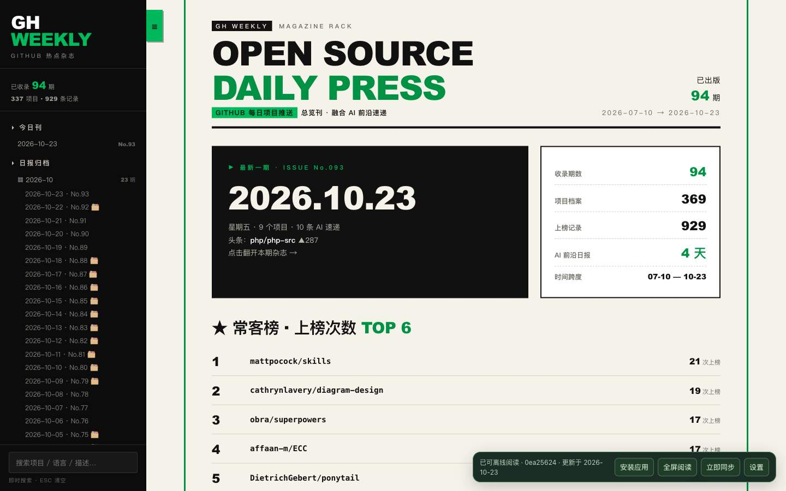

# GitHub 每日项目推送

**把 GitHub 热榜、AI 前沿资讯和项目档案，放进一本可安装、可离线阅读的中文杂志。**

黑绿杂志界面，按日、周、月、分类和项目时间线浏览。支持全文搜索、历史快照来源、第三方模型接口、Ollama，以及 GitHub Actions 自动采编。



## 三分钟启动

先安装 **Python 3.11 或更新版本**，下载本仓库并解压，或使用 Git 克隆。

- **Mac**：双击 `启动.command`。若系统不允许执行，可在终端进入本目录运行 `bash 启动.command`。
- **Windows**：双击 `启动.bat`。如果没有 Python，请先安装并启用 Python 启动器。

首次运行会安装依赖并打开 `http://127.0.0.1:8765/`。以后也可直接使用以下命令：

```bash
python -m venv .venv
# Mac / Linux
.venv/bin/python -m pip install -e .
.venv/bin/python -m gh_daily serve --open
# Windows 对应使用 .venv\Scripts\python.exe
```

首次安装需要联网下载依赖；仓库中已附带公开历史和构建后的阅读页面，不配模型也能阅读。

## 安装成应用

用 Chrome 或 Edge 打开本地地址，点击页面“安装”或浏览器菜单中的“安装此页面为应用”。安装后从系统应用图标进入独立窗口，没有普通浏览器的地址栏、标签页和书签栏。

等待页面显示“可离线阅读”后，即可关闭本地服务继续读缓存内容。**安装图标不会启动 Python 服务**；设置模型、生成或同步新内容时，请先运行启动脚本。浏览器缓存被清除后也需要重新启动服务。

## 配置自己的模型

打开工具栏“模型设置”，选择：

| 方式 | 填写内容 |
| --- | --- |
| 第三方兼容接口 | 服务商 API 根地址、API Key、模型名 |
| 本地 Ollama | 本地服务地址、已下载的模型名 |

可调整超时与输出上限，并测试连接。云端服务默认要求 HTTPS；Ollama 使用回环地址。密钥仅保存在用户配置目录，保存后不回显。详见[安装与模型设置](docs/安装与模型设置.md)。

## 自动更新有两种方式

**推荐：云端生成，本地阅读。** 在自己的 GitHub 仓库启用 Actions，配置自己的模型服务。每天北京时间 08:30 生成报告，检查后自动保存回该仓库。周一增加周报，每月第一天聚合上月月报。调度可能延迟，手动触发入口始终可用。

公开仓库需使用 `main` 作为默认分支。在本地设置页填写自己拥有或明确信任的公开仓库 `owner/repository`，点击“立即同步”。服务启动时及运行期间会检查更新，只替换阅读缓存，不修改本地源码或密钥。应用离线时显示上次缓存的内容。

也可完全在本地生成：

```bash
python -m gh_daily update
python -m gh_daily serve --schedule
```

使用虚拟环境的 Python 执行以上命令。云端不能直接调用个人电脑里的 Ollama；本地模式可以。详见[云端自动更新](docs/云端自动更新.md)和[自动采编](docs/自动采编.md)。

## 内容与证据

- 排名与星数来自 GitHub Trending 实际页面，介绍依据仓库资料；缺失数据明确标注。
- 补档保留 Wayback 快照标识和原链接，快照星数不代表当前值。
- AI 资讯先采集可追溯来源，再由模型解释；没有足够新材料时允许少报，失败不会冒充成功。
- 历史 HTML、Markdown、PDF 与项目档案附在仓库内。PDF 作为独立史料，不混入可解析 HTML 的榜单统计。

[数据来源](数据来源.md) · [补档说明](补档说明.md) · [验证范围](docs/验收记录.md)

## 常用命令

| 命令 | 用途 |
| --- | --- |
| `python -m gh_daily serve` | 启动本地应用 |
| `python -m gh_daily build` | 从已有资料重新构建 |
| `python -m gh_daily update` | 真实联网采编 |
| `python -m gh_daily sync --repo owner/repository` | 同步公开阅读内容 |
| `python -m gh_daily doctor` | 检查本地状态 |
| `python -m gh_daily privacy` | 扫描公开版资料 |
| `python -m unittest discover -s tests -v` | 执行回归测试 |

## 许可与贡献

原创代码使用 [MIT](LICENSE)。第三方项目、新闻、论文及历史材料保留各自权利，详情见 [NOTICE](NOTICE.md)。欢迎按[贡献说明](CONTRIBUTING.md)反馈问题；请勿在 Issue 中粘贴真实密钥或私人配置。
